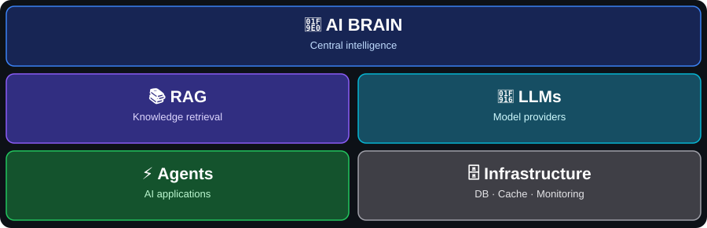
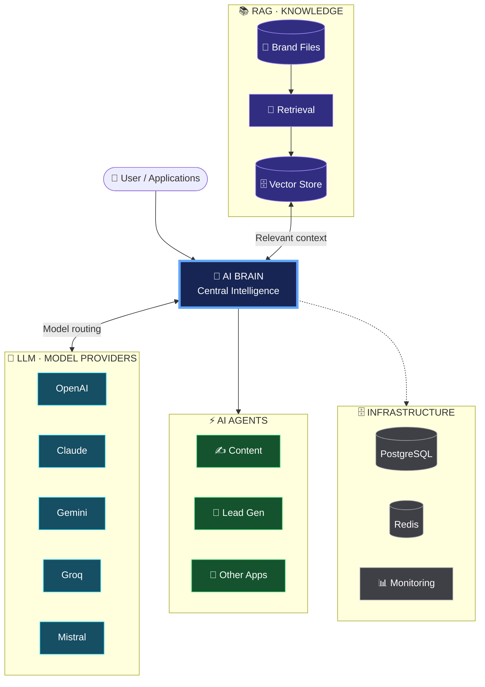

 

  

  
  
  
  

---

## 👋 About Me

I'm an AI Engineer focused on building **production-ready AI applications, LLM-powered products, and backend systems**.

Currently working as an **AI Associate, Founder's Office @ COG Culture**, where I work on internal AI products, LLM integrations, automation, and client-facing applications.

- 🚀 Contributed to an internal AI platform used across **4–5+ teams**, processing approximately **25M tokens/month**.
- 🧠 Building with RAG, multi-LLM orchestration, evaluation, and AI automation.
- ⚙️ Interested in reliability, observability, security, and scalable backend architecture.
- 🎓 B.Tech in Computer Science (AI & ML) · Microsoft Azure AI-900 certified.

---

## 🧠 How I Build AI Systems

  

### ⚙️ AI System Architecture

---

## 🚀 Featured Projects

### 1. LLM Gateway — Multi-Provider LLM Infrastructure

A production-oriented LLM gateway designed to handle provider failures, request routing, concurrency, cost controls, and asynchronous workloads.

**Engineering highlights**
- Multi-provider routing with automatic failover and circuit breakers.
- Redis-backed rate limiting, concurrency controls, and distributed coordination.
- PostgreSQL-backed asynchronous jobs with retries, idempotency, and dead-letter handling.
- Tenant-aware security, request guardrails, and budget reservations.
- Prometheus, Grafana, and OpenTelemetry for observability.
- Load testing and multi-instance reliability testing.

**Stack:** Python · FastAPI · Redis · PostgreSQL · Docker · Prometheus · Grafana · OpenTelemetry · k6

---

### 2. AI Content & Brand Intelligence Platform (Professional Experience — COG Culture)

An internal AI-powered copywriting platform designed to help marketing teams generate brand-aligned content through reusable prompt workflows and retrieval-augmented generation.

**Engineering highlights**
- 175+ reusable prompt templates for different copywriting workflows.
- RAG-based retrieval from winning campaign files and brand knowledge.
- Brand-specific context using structured Brand DNA.
- Multi-model fallback across Claude, GPT, and Gemini.
- Evaluation workflows, token tracking, and generation-cost monitoring.
- Brand-level data isolation and access control.

*Professional experience at COG Culture. Source code is not publicly available.*

---

### 3. Strapi CMS — Client Content Management System (Client Project)

A client CMS implementation using the open-source Strapi platform to manage structured website content through a dedicated content management backend.

**Core work**
- Open-source Strapi CMS setup and configuration.
- Structured content types and content modelling.
- API-driven content management.
- CMS and frontend integration.

**Stack:** Strapi · Node.js · SQLite · REST APIs

---

### 4. Lead Generation Agent Automation

An AI-powered lead generation and outreach workflow for discovering startup opportunities, enriching contact information, and supporting automated email outreach.

**Engineering highlights**
- Lead discovery and data extraction from startup and funding sources.
- Contact enrichment using Apollo.
- Automated email template generation and outreach workflows.
- Email thread tracking and engagement monitoring.

**Stack:** Python · LLM APIs · Selenium · Apollo · Gmail · Streamlit

---

### 5. RAG-Based PDF Summarizer & QA Chatbot

A document intelligence application that uses retrieval-augmented generation to summarize PDFs and answer questions using document context.

**Core concepts:** Document Processing · Embeddings · Retrieval · RAG · LLM-based Question Answering

---

## 🛠️ Tech Stack

**Languages**

  
  

**Frontend & Backend**

  
  
  
  
  
  
  
  

**Databases & Infrastructure**

  
  
  
  
  
  

**AI & LLM Ecosystem**

  
  
  
  
  
  
  

**Observability & Testing**

  
  
  
  
  

**Automation & Tools**

  
  
  
  

---

## 📫 Let's Connect

Interested in opportunities involving Applied AI, LLM engineering, and building reliable AI-powered products.

  <a href="mailto:tusharyadav61900@gmail.com">tusharyadav61900@gmail.com</a> ·
  <a href="https://www.linkedin.com/in/tushar-yadav-ai">LinkedIn</a> ·
  <a href="https://github.com/Tushar01yadav">GitHub</a>

