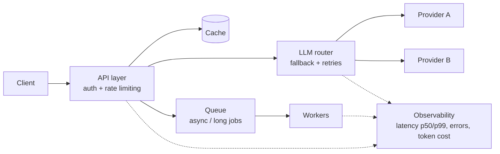

# Hey, I'm Tushar 👋

**AI Engineer** building production LLM systems: RAG, multi-LLM routing, and the backend around them.
AI Associate in the Founder's Office at COG Culture · Gurugram, India

I shipped an internal AI platform used across 4–5+ teams (~25M tokens/month), and I'm now going deeper into the systems side: reliability, observability, and security of LLM backends.

## How I think about LLM systems

A simplified version of the architecture I work with:

## What I'm building now

- **LLM Gateway + Observability** (in progress): a gateway with a live latency dashboard, load tests and security tests. *Repo coming soon.*
- **System design notes** (in progress): short decision records on the tradeoffs behind caching, queues, RAG and auth.

## Projects

| Project | What it is |
|---|---|
| [Lead-Generation-Agent-Automation](https://github.com/Tushar01yadav/Lead-Generation-Agent-Automation) | Automation pipeline for discovering, enriching and qualifying startup funding data |
| [RAG-Based-PDF-Summarizer-QA-Chatbot](https://github.com/Tushar01yadav/RAG-Based-PDF-Summarizer-QA-Chatbot) | PDF summarization and question answering with retrieval-augmented generation |

## Stack

`Python` `FastAPI` `Docker` `GCP` `PostgreSQL` `Redis` `LangChain` `n8n`

## Reach me

[LinkedIn](https://www.linkedin.com/in/tushar-yadav-ai) · [Email](mailto:YOUR_EMAIL_HERE)
