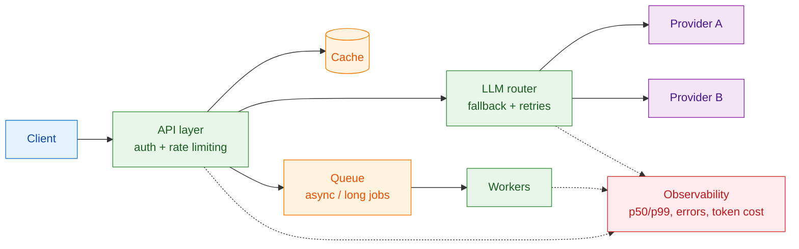

  

  
  
  
  

---

## 👋 About

I build **production LLM systems**: RAG pipelines, multi-LLM routing, and the backend around them.
Currently **AI Associate, Founder's Office @ COG Culture**.

- 🚀 Shipped an internal AI platform used across **4–5+ teams (~25M tokens/month)**
- 🔍 Now going deeper into the systems side: **reliability, observability and security** of LLM backends
- 🎓 B.Tech CS (AI & ML) · Microsoft Azure AI-900 certified

---

## 🧠 How I think about LLM systems

A simplified view of the architecture I work with:

---

## 🔨 Building now

| | Project | Focus |
|---|---|---|
| 🚧 | **LLM Gateway + Observability** | Gateway with live latency dashboard (p50/p99), load tests and security tests. *Repo coming soon.* |
| 📝 | **System Design Notes** | Short decision records on the tradeoffs behind caching, queues, RAG and auth. *Coming soon.* |

---

## 📦 Projects

| Project | What it does |
|---|---|
| 🎯 [**Lead-Generation-Agent-Automation**](https://github.com/Tushar01yadav/Lead-Generation-Agent-Automation) | Pipeline for discovering, enriching and qualifying startup funding data |
| 📄 [**RAG-Based-PDF-Summarizer-QA-Chatbot**](https://github.com/Tushar01yadav/RAG-Based-PDF-Summarizer-QA-Chatbot) | PDF summarization and Q&A using retrieval-augmented generation |

---
## 🛠️ Tech Stack

**Languages & Backend**

**Data & Infra**

**AI & Automation**

---

## 📫 Let's connect

  <a href="mailto:tusharyadav61900@gmail.com">tusharyadav61900@gmail.com</a> ·
  <a href="https://www.linkedin.com/in/tushar-yadav-ai">linkedin.com/in/tushar-yadav-ai</a>

